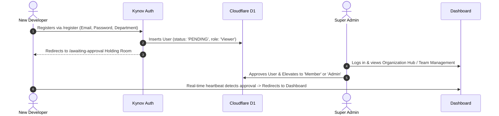

# Product Requirements Document (PRD) — KYNOV

**Document Version**: 2.0.0  
**Status**: Living Master Specification (Source of Truth)  
**Last Updated**: October 18, 2026  
**Product**: Kynov — Edge-Native Agile Velocity, Sprint Tracking & Knowledge Platform  
**Target Architecture**: Cloudflare Workers / Next.js 16 App Router / Cloudflare D1 (SQLite) / Cloudflare R2 / Serverless Edge

---

## 1. Executive Summary & Value Proposition

### 1.1 The Problem
Modern software development teams struggle with existing agile tracking platforms (such as Atlassian Jira, Linear, and Azure DevOps) due to three critical friction points:
1. **Predatory Per-Seat Pricing**: High per-user monthly SaaS subscription fees severely penalize scaling engineering teams, contract developers, and cross-functional stakeholders.
2. **Bloated & Sluggish UI Performance**: Client interfaces often suffer from 1.5s–4.0s page transitions, slow database queries, and laggy drag-and-drop kanban boards.
3. **Fragmented Workflows**: Issue tracking, Confluence-style living architecture documentation, sprint capacity modeling, and real-time team presence are split across disjointed third-party platforms.

### 1.2 The Value Proposition
**Kynov** is a zero-per-seat-cost, high-performance agile management and engineering intelligence suite built on serverless edge infrastructure.
- **Sub-25ms Edge Latency**: Powered by Cloudflare D1 distributed SQLite and Next.js 16 Edge runtime.
- **Unified Engineering Hub**: Combines an ultra-responsive Kanban workflow engine, Confluence-style rich Markdown documentation, 3D interactive glass folders, live Google Sheets embeds, and real-time multi-browser presence.
- **Enterprise Multi-Tenancy**: Zero Trust organization partitioning with comprehensive Role-Based Access Control (RBAC) and admin approval gates.

### 1.3 Target Users & Personas

| Persona | Role & Focus | Primary Goals in Kynov |
| :--- | :--- | :--- |
| **Engineering Leader / CTO** | Executive & Org Governance | Zero seat fees, SOC2-ready access control, global performance, live sprint velocity analytics. |
| **Scrum Master / Agile PM** | Sprint Cadence & Velocity | Manage sprints, establish WIP caps, burndown tracking, live Google Sheets capacity models. |
| **Fullstack / Staff Engineer** | Daily Execution & Architecture | Instant drag-and-drop board (<16ms), JQL compound search, keyboard shortcuts, ADR documentation. |
| **Contractor / External Viewer** | Read-Only Stakeholder | Safe read-only access to progress, architecture specs, and release checklists without licensing penalty. |

---

## 2. Core User Journeys & User Stories

### Journey 1: New Employee Onboarding & Admin Approval Gate


- **User Story 1.1**: *As an incoming engineer, I want to sign up with my work credentials and enter a secure holding room so that unauthorized individuals cannot view corporate sprint boards.*
- **User Story 1.2**: *As an Admin, I want to approve, reject, or elevate pending registrations with instantaneous UI feedback and immediate database update.*

### Journey 2: Sprint Execution & Drag-and-Drop Kanban Flow
- **User Story 2.1**: *As an engineer, I want to drag an issue card across swimlanes (To Do -> In Progress -> In Review -> Done) with optimistic UI updates and instant rollback if network fails.*
- **User Story 2.2**: *As a project manager, I want to configure Column WIP (Work In Progress) limits so that the team is immediately alerted with red visual indicators when bottlenecks occur.*
- **User Story 2.3**: *As a developer, I want to use JQL-lite compound filters (`assignee = currentUser() AND priority = High AND status != Done`) to locate tickets within milliseconds.*

### Journey 3: Living Knowledge & Architecture Decision Records (ADRs)
- **User Story 3.1**: *As a software architect, I want to document system decisions (ADR-001 through ADR-005) in rich Markdown with syntax highlighting and exportable PDF/Markdown formats.*
- **User Story 3.2**: *As a technical PM, I want to embed live Google Sheets spreadsheets directly within sprint folders, with native formula grid fallbacks and instant external sheet links.*
- **User Story 3.3**: *As a designer/developer, I want to navigate 3D interactive glass folders, drag-and-drop assets, and inspect attachments without external file storage delays.*

### Journey 4: Real-Time Cross-Browser Team Presence
- **User Story 4.1**: *As a remote team member, I want to see which team members are currently online in the workspace via live avatars and green pulsing beacons, synchronized across different browsers and devices.*
- **User Story 4.2**: *As a developer focusing on deep work, I want to toggle my status between "Active" and "Away" so my team knows my availability.*

---

## 3. Functional Requirements & Feature Specifications

### 3.1 Authentication & Workspace Partitioning
- **Auth Modes**: Credentials authentication with Argon2/SHA-256 password hashing; GitHub OAuth 2.0; Google Workspace OAuth 2.0.
- **Session Security**: Cryptographically signed HMAC HTTP-only cookies (`kynov_session`) with `SameSite=Lax` and `Secure` attributes.
- **Multi-Tenant Isolation**: Every SQL query filters strictly by `organization_id` derived from the session context.
- **Admin Approval Gate**: Newly registered accounts enter `status: 'PENDING'`. Only `APPROVED` users can query workspace data. `SUSPENDED` users receive HTTP 403.

### 3.2 Real-Time Collaborative Presence Engine
- **Server API Endpoint**: `/api/presence` (`GET` and `POST`) maintaining global process-level state.
- **Heartbeat Frequency**: Clients dispatch status heartbeats every 4,000ms.
- **Dual Matching**: Matches users by both `userId` and normalized `email`.
- **TTL Expiration**: Inactive connections are pruned after 25,000ms of inactivity.
- **Immediate Leave Beacon**: `window.beforeunload` triggers `navigator.sendBeacon('/api/presence', { status: 'OFFLINE' })`.

### 3.3 Kanban Board & Agile Filters
- **Columns & Workflow**: `To Do`, `In Progress`, `In Review`, `Done` with custom workflow transition rules.
- **Responsive 2-Tier Filter Ribbon**:
  - *Tier 1*: Full-width horizontal scrolling chip bar (`My Issues`, `Critical/High/Med/Low`, `Bug/Story/Task/Epic`, `Live/Demo`, Assignee facepile) protected against truncation at all zoom levels (80%–150%).
  - *Tier 2*: Priority dropdown, JQL-lite search bar, Epic filter, and live Metrics Status Capsules (`Total Issues`, `Active Count`, `Points Done`).
- **JQL-lite Query Engine**: Parses compound queries supporting `=`, `!=`, `>`, `<`, `>=`, `<=`, `~`, `currentUser()`, `priority`, `status`, `type`, `points`, `blocked`, and `epic`.

### 3.4 Confluence-Style Documentation & Asset Directory
- **Three Core Navigation Modes**:
  1. **Asset Hub (DocExplorer)**: Hierarchical directory tree, breadcrumbs, search filtering, grid/table view modes.
  2. **3D Glass Folders**: Liquid-glass panels rendered with domain-warped noise shaders, interactive click-to-open delegation, file drop animations, and native device file upload.
  3. **ADR Articles**: Notion/Confluence-style reader modal with Markdown formatting, code copy, and download capabilities.
- **Dual-Mode Spreadsheet Viewer (`GoogleSheetEmbedModal`)**:
  - *Mode 1 (Native Grid)*: High-reliability styled spreadsheet with formula bar (`fx`), sprint burndown calculations, and tabs (`Active Sprint 14`, `Developer Capacity`, `Burndown Calculation`).
  - *Mode 2 (Web Embed)*: Live Google Sheets iframe with sandbox security.
  - *Action Toolbar*: "Export CSV", "Copy Link", and "Open in Sheets" (direct new tab launcher).
- **Z-Index & Opacity Contract**: All modals use `z-[100]` with 100% solid, opaque headers (`bg-white dark:bg-[#0F1524]`) to guarantee zero background text bleed-through.

---

## 4. Roles & Permission Matrix (RBAC)

| Capability / Action | Super Admin | Admin | Member | Viewer / Pending |
| :--- | :---: | :---: | :---: | :---: |
| Access Dashboard & Sprints | Yes | Yes | Yes | Holding Room Only |
| Move / Drag Kanban Issues | Yes | Yes | Yes | Read Only |
| Create & Edit Issues | Yes | Yes | Yes | No |
| Delete Issues | Yes | Yes | No | No |
| Create / Edit Documents | Yes | Yes | Yes | Read Only |
| Upload Assets & Spreadsheets | Yes | Yes | Yes | No |
| Approve / Reject Users | Yes | Yes | No | No |
| Modify User Roles & Permissions | Yes | Yes | No | No |
| Delete Workspace / Org Settings | Yes (Owner Only) | No | No | No |

---

## 5. Non-Functional Requirements (NFRs)

1. **Performance & Latency**:
   - Time to Interactive (TTI): < 800ms on global 4G connections.
   - Kanban Card Drop Optimistic Update: < 16ms (60 FPS animation).
   - Cold Start API Latency: < 40ms on Cloudflare Edge Workers.
2. **Responsiveness & Zoom Resilience**:
   - Layout scales cleanly from 320px mobile viewports up to 4K ultra-wide monitors.
   - Full support for browser zoom levels from 50% to 200% without clipping, overlapping, or truncation.
3. **Accessibility (WCAG 2.1 AA)**:
   - All interactive controls have visible focus rings (`focus-visible:ring-2`).
   - 4.5:1 contrast ratio across both light and dark themes.
   - Screen reader ARIA tags on modals, facepiles, and tabs (`aria-expanded`, `aria-label`, `role="list"`).
4. **Reliability & Offline Tolerance**:
   - Optimistic state updates revert gracefully upon network rejection.
   - Server-side presence automatically heals upon connection reconnect.

---

## 6. Page & Screen Architecture

```
/
├── /landing                     # High-conversion product landing page & feature tour
├── /login                       # Authenticated session entry
├── /register                    # User onboarding & initial signup
├── /awaiting-approval           # Holding room state for pending approvals
├── /dashboard                   # Executive analytics, sprint velocity, top contributors
├── /projects/[projectId]        # Kanban Board, Swimlanes, Filter Ribbon, Quick Issue Modal
├── /projects/[projectId]/reports# Velocity burndown trajectories, story point burn metrics
├── /docs                        # Documentation Hub (Asset Hub, Glass Folders, ADR Articles)
├── /organization                # Organization Hub, Member management, Role assignments
├── /api/presence                # Real-time multi-browser presence synchronization
├── /api/docs/prd                # Live PRD download endpoint (always synchronized)
└── /sitemap.xml & /robots.txt   # Search engine & GEO AI bot indexing declarations
```

---

## 7. Data Requirements & SQLite D1 Schema

### 7.1 Core Entities
- **`users`**: `id`, `name`, `email`, `password_hash`, `role`, `status`, `auth_provider`, `department`, `avatar_url`, `created_at`, `updated_at`.
- **`organizations`**: `id`, `name`, `slug`, `owner_id`, `plan`, `allowed_domain`, `auto_join_enabled`, `created_at`.
- **`projects`**: `id`, `organization_id`, `name`, `key`, `description`, `lead_id`, `created_at`.
- **`issues`**: `id`, `project_id`, `key` (e.g. APEX-101), `title`, `description`, `type`, `priority`, `status`, `assignee_id`, `reporter_id`, `story_points`, `parent_issue_id`, `sprint_id`, `order_index`.
- **`documents`**: `id`, `organization_id`, `title`, `category`, `content`, `author_id`, `parent_id`, `created_at`, `updated_at`.
- **`doc_items` (Asset Directory)**: `id`, `name`, `type` (`folder`, `markdown`, `google_sheet`, `file_pdf`, `file_image`), `parent_id`, `google_sheet_metadata`, `file_metadata`.

---

## 8. State Transitions: Loading, Empty & Error States

- **Loading States**: Shimmer skeleton cards on Kanban board load; spinner overlays on document modals; live connection spinners on Google Sheet frames.
- **Empty States**:
  - *No Issues in Column*: "No issues in this stage. Drag tasks here to advance workflow."
  - *Empty Folder in Asset Directory*: "Folder is empty. Click + to drop new assets or upload files."
  - *No Search Results*: "No matching issues found for query. Click Reset to clear filters."
- **Error States**: Toast banners with retry actions on API failures; graceful fallbacks on blocked iframes with direct "Open in Sheets" buttons.

---

## 9. Living Specification Synchronization Strategy

To fulfill the architectural requirement that documentation and PRDs remain 100% synchronized with codebase features:
1. **Source of Truth**: [`PRD.md`](file:///c:/Users/wajih/Desktop/kynov/PRD.md) is stored at the repository root and tracked in version control.
2. **Download API**: Served dynamically via `GET /api/docs/prd`, allowing any user in the web application to download the live markdown specification.
3. **Asset Hub Integration**: Pinned inside the Knowledge Hub under [`components/docs/DocExplorer.tsx`](file:///c:/Users/wajih/Desktop/kynov/components/docs/DocExplorer.tsx) so team members can inspect the spec in-app or download it instantly.
4. **CI/Build Verification**: Synchronized during `npm run docs:sync` prior to production deployments.
